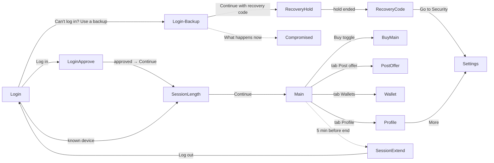
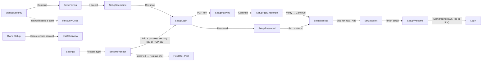
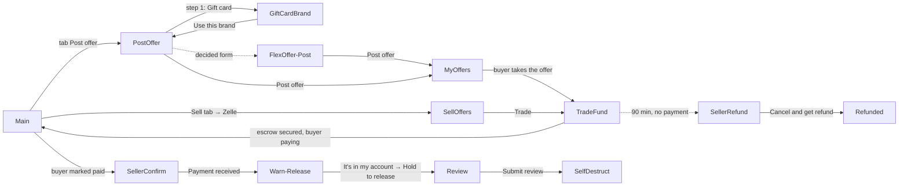
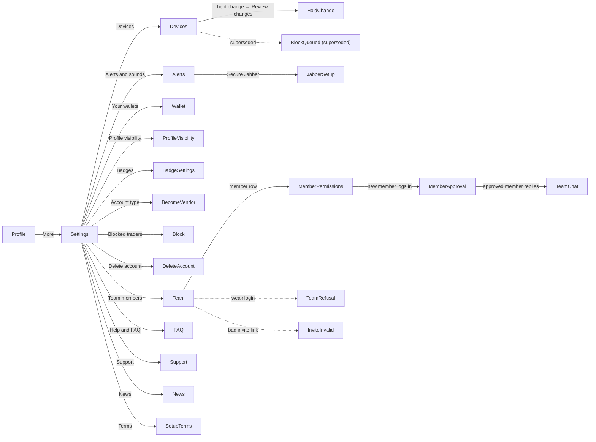
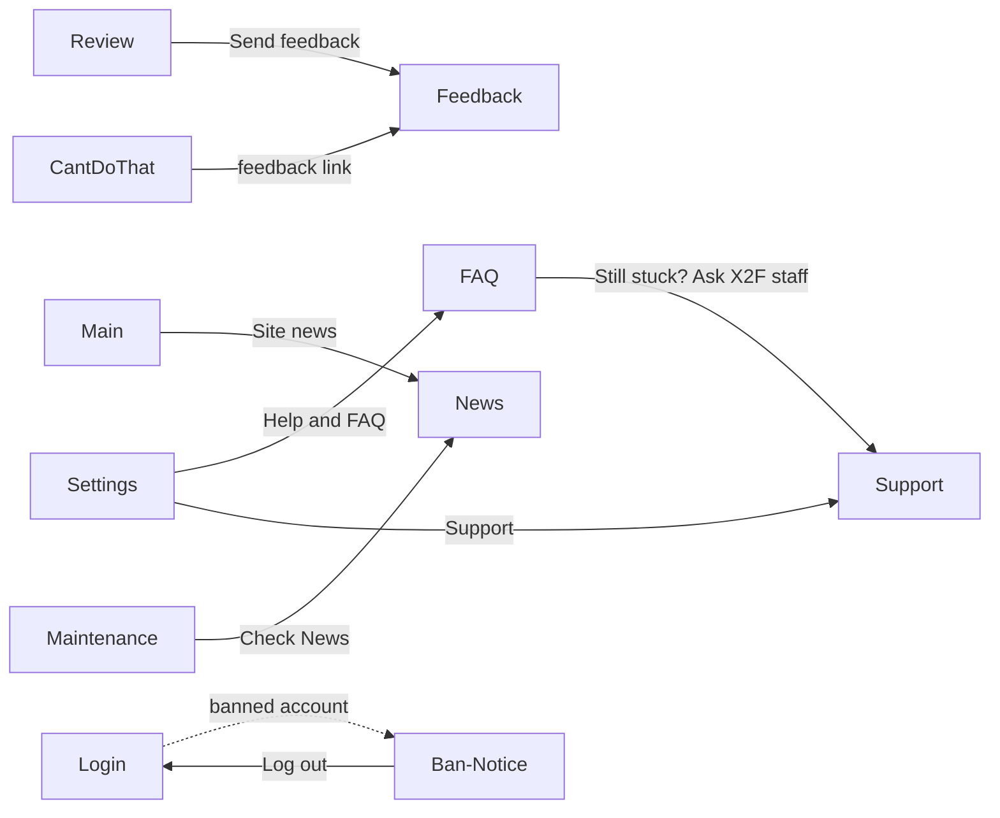
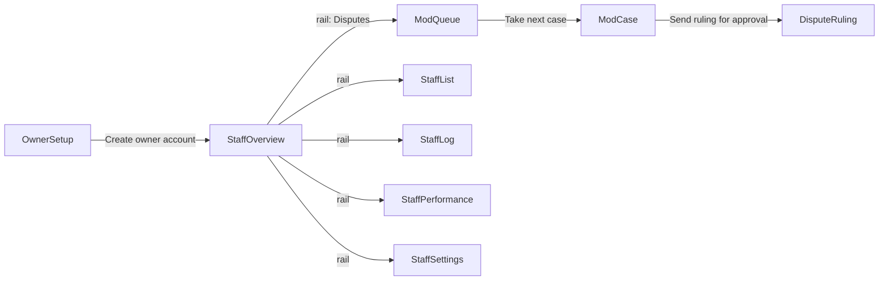
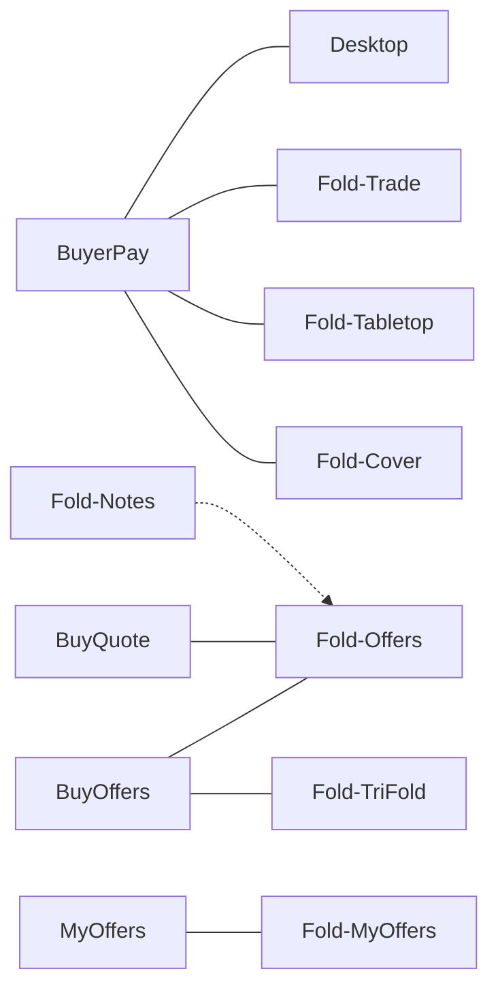

```mermaid
flowchart LR
  BuyMain -->|"Zelle"| BuyOffers
  BuyOffers -->|"Trade"| BuyQuote
  BuyOffers -->|"row"| OfferAd
  OfferAd -->|"Buy from satoshi_ghost"| BuyQuote
  FlexOfferQuote["FlexOffer-Quote"] -->|"Trade"| BuyQuote
  BuyQuote -->|"Trade"| TradeFund
  TradeFund -->|"escrow secured"| BuyerPay
  BuyerPay -->|"Add payment proof"| ProofBlur
  ProofBlur -->|"Send to satoshi_ghost → I've paid"| BuyerPaidWaiting
  BuyerPay -.->|"superseded"| WarnIvePaid["Warn-IvePaid (superseded)"]
  BuyerPay -->|"Cancel trade"| CancelRequest
  CancelRequest -->|"cancelled"| Refunded
  BuyerPaidWaiting -->|"Open dispute (after 90 min)"| DisputeOpen
  DisputeOpen --> DisputeRoom
  DisputeRoom -->|"ruling"| DisputeRuling
  DisputeRuling -->|"File appeal"| AppealNotice["Appeal-Notice"]
  AppealNotice -->|"reversal, losing side"| LienNotice["Lien-Notice"]
  DisputeRuling -.->|"refund variant"| Refunded
  BuyerPay -.->|"incident"| TradeTechIssue
  BuyerPaidWaiting -->|"seller releases"| SelfDestruct
  SelfDestruct -->|"Leave a review"| Review
  Review -->|"Submit review"| Reviews
```

# X2F app flow map (8 Nov 2026)

For the build team: which screen leads to which, in what order, so a working demo can be wired from the finished boards. Companion canvas board: **FlowMap** (1280 wide, in the Foldables row of the canvas) draws the same map.

Sources: the 134 boards in `docs/design-boards/` (each board's back/close links, buttons and design notes), `DESIGN-HANDOFF-2026-11-06.md`, the owner decisions of 6 and 7 Nov (`owner-decisions-2026-11-06.md` on `comms`), and the routes on `main` (`apps/web/src/App.tsx`, `ui/BottomNav.tsx`, `ui/DesktopShell.tsx`).

## How to read this

- Each section is a numbered screen order. `→` is the move; the text in parentheses is the trigger (button, link or event). Board names are in **bold** and are the file name without `.dc.html`.
- **State** is the tweak (`data-props` on the board) to set so the screen shows that step. `theme` is on every board (night / day) and is not repeated.
- **Route**: "build" is what `App.tsx` on `main` already serves. "proposed" is a route that follows the build's existing names (`/sell`, `/buy`, `/trade/:code`, `/settings/…`) where nothing exists yet. Trade codes look like `K7M2-9QXA-4FTR-8WPN` (`/trade/K7M2`).
- Every phone board whose name has a `-Wide` twin is the same screen at ≥ 1000 px (wide rail layout). The twin is not listed as a separate step; its tweaks are the same.
- Marks: `SUPERSEDED` = keep for reference, do not build; `DRAFT` = the board says "Draft copy" (owner has not signed the words; layout stands).
- Example cast (one set of facts on every board): buyer **mira.k**, seller/vendor **satoshi_ghost**, trade **K7M2-9QXA-4FTR-8WPN**, 1.250000 XMR for $412.50 via Zelle at $330.00 / XMR, fee 1 % (0.012500 XMR), buyer receives 1.237500 XMR.

## Screen count by section

| Section | Screens (phone boards) | Wide twins | Notes |
|---|---|---|---|
| 1 Entry and shell | 12 | 8 | incl. nav tabs and rail |
| 2 Signup | 12 | 1 | incl. OwnerSetup, BecomeVendor branches |
| 3 Buy flow | 19 | 8 | Warn-IvePaid superseded |
| 4 Sell flow | 11 | 5 | incl. GiftCardBrand, Block, TeamChat |
| 5 Settings and account | 18 | 11 | BlockQueued superseded |
| 6 Help and notices | 7 | 7 | CantDoThat is a shared popup |
| 7 Staff app | 7 | 0 | all 1280 wide |
| 8 Fold / desktop | 9 | 0 | same screens at other widths |

Distinct boards placed: 134 of 134 (the two superseded and the Badges proposal included).

---

## 1. Entry and shell

### Screen order

1. **Login** (`method` = `pgp`; the app opens here when nobody is logged in) → 2 (primary `{{cta}}` = "Log in" / "Use my passkey" per method). Branches: "Can't log in? Use a backup" → 1a; a new device → 3.
   - 1a. **Login-Backup** (`view` = `enter`) → **RecoveryHold** (`step` = `hold`, `variant` = `wait`) after "Continue with recovery code"; `view` = `held` shows the hold inside Login-Backup. RecoveryHold "End the hold early" (`variant` = `can-end-early`, `step` = `pick-method`) → `step` = `ended` → **RecoveryCode** (`step` = `show`, "Write down your new recovery code") → "Go to Security" → **Settings**. RecoveryHold "Back to log in" → 1.
   - 1b. **Compromised** (`step` = `form`) is reached from Login-Backup "What happens now" / Settings › Security "My account has been compromised" → "Freeze my account" → `step` = `confirm` → "Yes, freeze it now" → `step` = `frozen` (dead end: everyone logged out; Matrix / Telegram links).
2. **LoginApprove** (`side` = `new`, `newView` = `waiting`; shown on the new device after step 1 when the account has "One device at a time" or 3 devices in use). On the known device the same board with `side` = `existing` ("Yes, let them in" / "Log it out and let them in" / "No, block it"). `newView` = `approved` → "Continue" → 3; `newView` = `blocked` → "Back to log in" → 1. "Change login method" → **SetupLogin**.
3. **SessionLength** (`step` = `ask`, `menu` = `closed`; every login asks, nothing preselected: traders 2/4/8/12 h, vendors 2/6/12/24 h) → "Continue" (`step` = `done`) → 4. Link "Devices and sessions" → **Devices**.
4. **Main** (the app shell: Sell tab of Trade). Buy/Sell segmented control → **BuyMain**. Bottom nav (phone) and wide rail from here.
5. **SessionExtend** (`step` = `ask`, `methods` = `strong`; event: 5 min before the session ends, over any screen) → "Stay logged in" (`step` = `extended`) stays on the current screen; "Log out" or timeout (`step` = `logged-out`) → "Log in" → 1.

### Phone bottom nav (BottomNav.tsx, four tabs; the Main board's bar)

| Tab | Board | Build route | Note |
|---|---|---|---|
| Trade | **Main** (Sell) / **BuyMain** (Buy) | `/sell`, `/buy` | one tab, Buy/Sell toggle at the top of the screen |
| Post offer | **PostOffer** (FlexOffer-Post is the decided form, see §4) | `/post` | hidden for a team member without the Offers permission |
| Wallets | **Wallet** | `/wallets` | |
| Profile | **Profile** | `/profile` (tab exists, no route yet) | Profile "More" → **Settings** |

### Wide rail (≥ 1000 px; six items, icons from Devices-Wide; every `-Wide` board carries it)

| Rail item | Board | Route |
|---|---|---|
| Trade | **Main** / **BuyMain** at wide = **Desktop** shell with the browse lists | `/sell`, `/buy` |
| Post offer | **FlexOffer-Post-Wide** | `/post` |
| Wallets | **Wallet** (no wide twin; Settings-Wide links `Wallet-Wide`, not drawn) | `/wallets` |
| Profile | **Profile** (no wide twin drawn) | `/profile` |
| Settings | **Settings-Wide** | `/settings` (proposed; build has `/settings/security` etc.) |
| Help | **FAQ-Wide** | `/help` (proposed) |

Note: `DesktopShell.tsx` on `main` still draws the older Buy / Sell / My trades / Wallets header. The boards' rail (Trade, Post offer, Wallets, Profile, Settings, Help) is the current standard (handoff §1.2, standard 1); `/trades` ("Back to my trades", "My trades") has no board of its own: it is the "Active trades" section at the top of **Main**.

### Pre-login wordmark pages (plain ink X2F wordmark, no nav)

**Login**, **Login-Backup**, **LoginApprove**, **RecoveryHold**, **RecoveryCode** (`step` = `show` at signup), **Compromised**, **SessionExtend** (`step` = `logged-out`), **SessionLength**, **InviteInvalid**, **MemberApproval** (`side` = `member`), **Maintenance**, **OwnerSetup**, **SignupSecurity**.

### Table

| Screen | Board file | Route (build / proposed) | Primary action | State to show |
|---|---|---|---|---|
| Login | `Login.dc.html` (+Wide) | `/login` build | Log in / Use my passkey | `method=pgp` |
| Login-Backup | `Login-Backup.dc.html` (+Wide) | `/login/backup` build | Continue with recovery code | `view=enter` |
| RecoveryHold | `RecoveryHold.dc.html` (+Wide) | `/login/hold` proposed | End the hold early | `variant=wait`, `step=hold` |
| RecoveryCode | `RecoveryCode.dc.html` (+Wide) | `/setup/recovery` proposed (also after a hold) | I wrote it down → Continue | `step=show`, `entry=empty` |
| Compromised | `Compromised.dc.html` (+Wide) | `/login/compromised` proposed | Freeze my account | `step=form`, `ticket=show`, `tickRule=required` |
| LoginApprove | `LoginApprove.dc.html` (+Wide) | `/login/approve` proposed | Yes, let them in (existing) / Continue (new) | `side=new`, `newView=waiting`, `devices=2 in use` |
| SessionLength | `SessionLength.dc.html` (+Wide) | `/login/session` proposed | Continue | `step=ask`, `accountType=non-vendor`, `menu=closed` |
| SessionExtend | `SessionExtend.dc.html` (+Wide) | overlay, no route | Stay logged in | `step=ask`, `accountType=trader`, `methods=strong` |
| Main | `Main.dc.html` | `/sell` build | (none: browse) | — |
| BuyMain | `BuyMain.dc.html` | `/buy` build | (none: browse) | — |
| Wallet | `Wallet.dc.html` | `/wallets` build | Save wallet | — |
| Profile | `Profile.dc.html` | `/profile` proposed | Message | `volumeLine=on` |

### Mermaid

---

## 2. Signup

Owner decisions that shape the order: a username is mandatory on every account (G6/G34); after signup the person goes back to Login, logs in and then picks a session length (G25); "of 5" step count (Q18); the 60-day inactivity rule is in the rules list at the end (p4-5).

### Screen order

1. **SignupSecurity** (`variant` = `strong`, `meter` = `strong`; the first screen of "Set up your account · Takes about 2 minutes", five-bar stepper) → "Continue" → 2. Branch: `variant` = `weak` / `not-allowed` keeps the person here; **RecoveryCode** (`step` = `show`) is reached from SignupSecurity-Wide "Continue" when the chosen method needs a code.
2. **SetupTerms** (step 0 of the stepper, "Terms of Service") → "I accept" → 3. Links: Terms of Service, Privacy Policy. Also reachable from Settings › Terms and from PostOffer / SellOffers (terms changed, must re-accept).
3. **SetupUsername** ("1 · Pick a username") → "Continue" → 4. Back → 2.
4. **SetupLogin** ("2 · How do you want to log in?") → `{{cta}}` → 5a (PGP key) or 5b (password). Back → 3. Also reached from LoginApprove / BecomeVendor / Settings › Login methods ("Add a passkey, security key or PGP key").
5. a. **SetupPgpKey** ("3 · Paste your public key") → "Continue" → **SetupPgpChallenge** ("3 of 5 · part 2", "Prove it's your key") → "Verify" then "Continue" → 6. Back → SetupPgpKey.
   b. **SetupPassword** ("Alt 3 · Choose a password") → "Set password" → 6. Back → 4.
6. **SetupBackup** ("4 · Backup way to log in (optional)") → "Add {{choice}}" (adds the picked method, returns here) or "Skip for now" → 7. Back → 5.
7. **SetupWallet** ("5 · Where should we send your XMR?") → "Finish setup" → 8. Back → 6.
8. **SetupWelcome** ("Welcome to X2F", NEW badge) → "Start trading" → **Login** (G25: log in, then SessionLength) → **Main**. Link "Settings" → **Settings**.

Branches
- **OwnerSetup** (1280, first run of the site only): "Tap key to register" (security key) + "Add PGP key" → "Create owner account" → **StaffOverview**. Not reachable from the trader app.
- **BecomeVendor** (`state` = `not-met`, `extraReq` = `strong-login-only`; Settings › Account type): "Add a passkey, security key or PGP key" → **SetupLogin**; `state` = `met` → "Switch to a vendor account" → confirm "Switch to vendor" → `state` = `switched` → "Post an offer" → **FlexOffer-Post** / "Go to my offers" → **MyOffers**. `switchBack` = `blocked-while-live` for the reverse.
- **MemberApproval** (`side` = `member`, `state` = `waiting`; a team member's first login on a team) → `approved` → "Continue" → **Main**; `refused` → "Back to log in". Lead side in §5.

### Table

| Screen | Board file | Route (build / proposed) | Primary action | State to show |
|---|---|---|---|---|
| SignupSecurity | `SignupSecurity.dc.html` (+Wide) | `/setup` build (SetupStart) | Continue | `variant=strong`, `meter=strong`, `pwRule=A-12-mixed`, `vaultRule=yes-passwordless` |
| SetupTerms | `SetupTerms.dc.html` | `/terms` build | I accept | — (DRAFT: lawyer text) |
| SetupUsername | `SetupUsername.dc.html` | `/setup/name` build | Continue | — |
| SetupLogin | `SetupLogin.dc.html` | `/setup/login` build | Continue with PGP key | — |
| SetupPgpKey | `SetupPgpKey.dc.html` | `/setup/pgp-key` build | Continue | — |
| SetupPgpChallenge | `SetupPgpChallenge.dc.html` | `/setup/pgp-code` build | Verify | — |
| SetupPassword | `SetupPassword.dc.html` | `/setup/password` build | Set password | — |
| SetupBackup | `SetupBackup.dc.html` | `/setup/backup` build | Add a passkey / Skip for now | — |
| SetupWallet | `SetupWallet.dc.html` | `/setup/wallet` build | Finish setup | — |
| SetupWelcome | `SetupWelcome.dc.html` | `/setup/welcome` build | Start trading | — |
| OwnerSetup | `OwnerSetup.dc.html` | `/staff/setup` proposed | Create owner account | — |
| BecomeVendor | `BecomeVendor.dc.html` (+Wide) | `/settings/account-type` proposed | Switch to a vendor account | `state=met`, `extraReq=strong-login-only`, `switchBack=blocked-while-live` |

### Mermaid

---

## 3. Buy flow (mira.k buys 1.250000 XMR from satoshi_ghost)

Owner rules in force: "Pay now" and "I've paid" never show before the escrow is secured (Q12); the buyer may cancel after escrow until "I've paid", then only a dispute (g67); after "I've paid" the buyer waits 90 min for instant methods before a dispute can open (F9); trade code, amount and time are never blurred (Q50); a buyer-cancel refund is final, so the warning comes before the cancel (G56).

### Screen order

1. **BuyMain** (Buy toggle on the Trade tab; pick how you pay) → tap a method row (Zelle) → 2.
2. **BuyOffers** ("Buy XMR via Zelle", sellers list, sort chips) → "Trade" on a seller row → 3; tapping the row → 3a; badge / "+3" → badge sheet (see OfferAd).
   - 3a. **OfferAd** (`side` = `selling`, menus `closed`; the seller's full ad: currency and payment dropdowns, bands, instructions) → `{{ad.cta}}` "Buy from satoshi_ghost" → 3. **FlexOffer-Quote** (`variant` = `greyed`) is the list + quote in the flexible-offer model; its first available "Trade" → 3.
3. **BuyQuote** ("Buy from satoshi_ghost": amount, wallet, what you get) → "Trade" → 4. "Add another wallet" → **Wallet**.
4. **TradeFund** (seller funds escrow; the buyer sees the trade room in the "Escrow securing" state) → event: escrow secured → 5. Buyer may "Cancel trade" at once here (before escrow).
5. **BuyerPay** (`escrow` = `securing` first, then `secured`: the PAY NOW caution hero, "Send exactly $412.50", Zelle to, memo = trade code, timer 90 min). "Add payment proof" → 6. "Cancel trade" → 5b. "Open dispute" (only after the wait) → 7b.
   - 5a. **Warn-IvePaid** `SUPERSEDED` (the "wait until the XMR is fully in escrow" sheet; under Q12 the buyer can never reach "I've paid" before the escrow is secured). Keep the board for reference; do not wire. The confirm "Mark as paid?" (Not yet / Yes, mark as paid) now lives inside BuyerPay.
   - 5b. **CancelRequest** (`side` = `buyer`, `step` = `buyer-confirms`: the G56 "this is likely final" warning) → "Cancel trade" → `step` = `returning` → `step` = `cancelled` → **Refunded** (`variant` = `buyer-cancelled`) → "Find another offer" → 2 / "Back to my trades" → **Main**. "Keep trading" → 5.
6. **ProofBlur** (`step` = `review`, `removeAuto` = `add-only`, `protect` = `warn`, `date` = `found`: automatic blur, uploader can only add blur; the warning shows when the uploader's own blur covers the amount or memo) → "Add blur" (`step` = `drawing`) → "Preview as seller" (`step` = `preview`) → "Send to satoshi_ghost" (`step` = `sent`) → back on 5 with the proof attached → "I've paid" → "Yes, mark as paid" → 7. `date` = `missing` asks for a fresh screenshot (G16).
7. **BuyerPaidWaiting** (`window` = `in-window`: "Waiting for the seller", hourglass, "Nudge satoshi_ghost" every 15 min with the horn; `after-wait` enables "Open dispute"; `ended`) → event: seller releases → 8. "Open dispute" → 7b.
   - 7b. **DisputeOpen** (reason + what happened, "Open dispute" / "Not now" → 7) → **DisputeRoom** (`moderator` = `waiting`: 24 h hourglass; then `joined`: moderator sarah.v in the chat, primary "Send unblurred proof to sarah.v") → **DisputeRuling** (`variant` = `release`: "Dispute decided · Release to the buyer · The 1.250000 XMR goes to you"; "File appeal" opens the appeal sheet; "Back to my trades") → **Appeal-Notice** (`variant` = `open` → `filed` → `waiting` → `decided` → `closed`; senior moderator) → **Lien-Notice** (only for the losing side of a reversal: "Trading paused until you repay mira.k", "Repay 1.250000 XMR", "Read the decision" → Appeal-Notice). The refund side of a ruling: **Refunded** (`variant` = `moderator`, "Read the ruling and appeal").
   - 7c. **TradeTechIssue** (`side` = `partner`, `case` = `funded-you-bought`; event: the other account is held or a technical incident, incident ID at the top) → `case` = `resolved-resume` → back to 5/7, or `resolved-refund` → **Refunded**. "Back to my trades" → **Main**.
8. **SelfDestruct** (`view` = `trade`, `trade` = `completed`: the finished trade room, COMPLETED hero, "This trade self-destructs on 28 Nov 2026", chat) → "Leave a review" → 9. `view` = `privacy` is the "How deletion works" sheet.
9. **Review** (RELEASED hero "1.237500 XMR is yours", confirmations 1 of 10, "View on the Monero blockchain", then the review form: stars, "What stood out?", "Describe this trade", "In your own words") → "Submit review" / "Skip review" → **Main** (Active trades gone) and → 10.
10. **Reviews** (`view` = `profile`: the review as it shows on satoshi_ghost's profile; `view` = `write` is the same form as Review, one form everywhere; "Dispute this review" for the vendor).

Also on the buyer's side: **Block** (`view` = `chat`: "Block nightowl_44" from a trade chat's "More"; `view` = `profile` from Profile; `view` = `settings` is the blocked list) and **TeamChat** (`viewer` = `partner`: a team member answering in the seller's chat, "replying for satoshi_ghost").

### Table

| Screen | Board file | Route (build / proposed) | Primary action | State to show |
|---|---|---|---|---|
| BuyMain | `BuyMain.dc.html` | `/buy` build | pick a method | — |
| BuyOffers | `BuyOffers.dc.html` | `/buy/zelle` build (`/buy/:methodId`) | Trade | — |
| OfferAd | `OfferAd.dc.html` (+Wide) | `/buy/zelle/ad-4821` proposed (`/buy/:methodId/:offerId`) | Buy from satoshi_ghost | `side=selling`, `volumeLine=on`, menus `closed`, `badges=closed` |
| FlexOffer-Quote | `FlexOffer-Quote.dc.html` (+Wide) | `/buy/zelle` build (replaces BuyOffers in the flexible model) | Trade (first available) | `variant=greyed` |
| BuyQuote | `BuyQuote.dc.html` | `/buy/zelle/satoshi_ghost` build (`/buy/:methodId/:offerId`) | Trade | — |
| TradeFund | `TradeFund.dc.html` | `/trade/K7M2` build | (seller: Open in Cake Wallet) | — |
| BuyerPay | `BuyerPay.dc.html` (Desktop at wide) | `/trade/K7M2` build | I've paid | `escrow=secured` (demo both) |
| Warn-IvePaid | `Warn-IvePaid.dc.html` (+Wide) | none, SUPERSEDED | — | — |
| CancelRequest | `CancelRequest.dc.html` (+Wide) | `/trade/K7M2/cancel` proposed (sheet) | Cancel trade | `side=buyer`, `step=buyer-confirms` |
| Refunded | `Refunded.dc.html` (+Wide) | `/trade/K7M2` build (state) | Find another offer | `variant=buyer-cancelled` |
| ProofBlur | `ProofBlur.dc.html` (+Wide) | `/trade/K7M2/proof` proposed | Send to satoshi_ghost | `step=review`, `removeAuto=add-only`, `protect=warn`, `date=found` |
| BuyerPaidWaiting | `BuyerPaidWaiting.dc.html` (+Wide) | `/trade/K7M2` build (state) | Nudge satoshi_ghost | `window=in-window` |
| DisputeOpen | `DisputeOpen.dc.html` | `/trade/K7M2/dispute` build | Open dispute | — |
| DisputeRoom | `DisputeRoom.dc.html` | `/trade/K7M2?view=chat` build (dispute slot) | Send unblurred proof to sarah.v | `moderator=joined` |
| DisputeRuling | `DisputeRuling.dc.html` | `/trade/K7M2/ruling` proposed | File appeal | `variant=release` |
| Appeal-Notice | `Appeal-Notice.dc.html` (+Wide) | `/trade/K7M2/appeal` proposed | File appeal / Send appeal | `variant=open` |
| Lien-Notice | `Lien-Notice.dc.html` (+Wide) | `/notice/lien` proposed (full-screen notice) | Repay 1.250000 XMR | — |
| TradeTechIssue | `TradeTechIssue.dc.html` (+Wide) | `/trade/K7M2` build (state) | Back to my trades | `case=funded-you-bought`, `side=partner` |
| SelfDestruct | `SelfDestruct.dc.html` (+Wide) | `/trade/K7M2` build (state) | Leave a review | `view=trade`, `trade=completed` |
| Review | `Review.dc.html` | `/trade/K7M2/review` proposed | Submit review | — (DRAFT copy) |
| Reviews | `Reviews.dc.html` (+Wide) | `/profile/satoshi_ghost` proposed | — | `view=profile` |
| Block | `Block.dc.html` (+Wide) | `/settings/blocked` build (`view=settings`) | Block nightowl_44 | `view=chat` |
| TeamChat | `TeamChat.dc.html` (+Wide) | `/trade/K7M2` build (state) | — | `viewer=partner` |

### Mermaid

---

## 4. Sell flow (satoshi_ghost posts an offer; mira.k takes it)

Owner rules: FlexOffer-Post is the form (Q4): market ± % only, Above/Below + typed % max 50 (F1), max 3 bands per currency and 5 payment types (Q23), 3 buy + 3 sell offers (F8); gift cards stay, with the 32 + Other brand list (p5-6); the seller may cancel and get the escrow back 90 min after it is fully funded (g66); releasing takes "Hold to release 1.250000 XMR".

### Screen order

1. **Main** (Sell tab) → tab "Post offer" → 2.
2. **PostOffer** (the older 3-step form; OPEN box: PostOffer vs FlexOffer-Post, the owner chose the flexible form) → step 1 "Gift card" method → 2a; "Post offer" → 3. Decided form: **FlexOffer-Post** (`example` = `filled`, `margin` = `ok`: What you trade → Price bands → Payment methods → Who can trade with you) → "Post offer" → 3. `example` = `overlap` and `margin` = `too-high` are the two error states.
   - 2a. **GiftCardBrand** (`picked` = `amazon`; the brand list, 32 + Other) → "Use this brand" → back into step 1 of PostOffer.
3. **MyOffers** (`hold` = `off`, `rate` = `all`; "2 bands · follows the market", Turn on/off per offer) → "Edit" → FlexOffer-Post; "Post an offer" → 2. `hold` = `on` shows the hold notice without a date; `rate` = `one-missing` / `none` is the "no rate right now" state (F4).
4. Event: a buyer takes the offer → **TradeFund** ("1 · Seller funds escrow": "Open in Cake Wallet" / "Use another wallet (QR code or address)", 28 min 42 s caution ring) → event: escrow secured → the seller waits for payment (the seller's view of 5 in §3 is the "Selling to mira.k · Waiting for payment" row on **Main**).
   - 4a. **SellerRefund** (`cancel` = `locked` until 90 min after funding, then `available`: "Nudge mira.k", "Give 30 more min", "Cancel and get refund") → **Refunded** (`variant` = `time-ran-out`).
   - 4b. The seller taking a buy offer instead: **Main** → **SellOffers** ("Sell XMR via Zelle: buyers paying via Zelle") → "Trade" (or **OfferAd** `side` = `buying`) → **TradeFund**.
5. Event: buyer marks paid → **SellerConfirm** (`blurCheck` = `ask`, `date` = `found`: hero chip + key mark + lead + timer, proof thumbnail, "Was this blurred correctly? Yes / No", "Payment not received", "Open dispute") → "Payment received" → 5a.
   - 5a. **Warn-Release** (the sheet: "It's in my account" / "I'll check again") → "It's in my account" → back on SellerConfirm: tick the box, "Hold to release 1.250000 XMR" → 6.
6. **Review** (the seller's Released view: "See the buyer's view and review" link on SellerConfirm) → "Submit review" → **Main**. Then **SelfDestruct** (`view` = `trade`) is the finished trade.

Vendor-side extras: **TeamChat** (`viewer` = `lead`: the lead sees a member's reply in the trade chat), **Block** (`view` = `chat`), **BecomeVendor** (§2).

### Table

| Screen | Board file | Route (build / proposed) | Primary action | State to show |
|---|---|---|---|---|
| PostOffer | `PostOffer.dc.html` | `/post` build | Post offer | — (older form; OPEN box) |
| FlexOffer-Post | `FlexOffer-Post.dc.html` (+Wide) | `/post` build (decided form) | Post offer | `example=filled`, `margin=ok` |
| GiftCardBrand | `GiftCardBrand.dc.html` | `/post/brand` proposed (sheet) | Use this brand | `picked=amazon` |
| MyOffers | `MyOffers.dc.html` (+Wide, Fold-MyOffers) | `/profile/offers` build | Post an offer | `hold=off`, `rate=all` |
| SellOffers | `SellOffers.dc.html` | `/sell/zelle` build (`/sell/:methodId`) | Trade | — |
| TradeFund | `TradeFund.dc.html` | `/trade/K7M2` build | Open in Cake Wallet | — |
| SellerRefund | `SellerRefund.dc.html` | `/trade/K7M2` build (state) | Cancel and get refund | `cancel=available` |
| SellerConfirm | `SellerConfirm.dc.html` | `/trade/K7M2` build (state) | Hold to release 1.250000 XMR | `blurCheck=ask`, `date=found` |
| Warn-Release | `Warn-Release.dc.html` (+Wide) | sheet over `/trade/K7M2` | It's in my account | — |
| Review | `Review.dc.html` | `/trade/K7M2/review` proposed | Submit review | — |
| Refunded | `Refunded.dc.html` (+Wide) | `/trade/K7M2` build (state) | Back to my trades | `variant=time-ran-out` |
| TeamChat | `TeamChat.dc.html` (+Wide) | `/trade/K7M2` build (state) | — | `viewer=lead` |

### Mermaid

---

## 5. Settings and account

Owner rules: a username-and-password login puts every important change on a 24 h hold, removals included (p5-7); the waiting-changes view lists each change with a countdown, "Cancel all changes" or untick single ones (g65); strong logins see the same view and apply at once (G29); only a team lead can kick members (G57); members may not use a stronger login than the lead (p4-8); secure Jabber notifications are a new feature (p5-7).

### Screen order (hub and spokes)

1. **Settings** (`accountType` = `trader`; vendor shows the Team row. Groups: Account, Security, Wallets, Team, Alerts, Privacy, About) is reached from Profile "More", SetupWelcome "Settings", RecoveryCode "Go to Security" and the wide rail. Each row opens one screen; back returns here.
2. Account rows: Display name / Username (inline), Account type → **BecomeVendor**, Badges → **BadgeSettings** (Featured / When tapped / Hidden per badge; back → **Profile**), Profile visibility → **ProfileVisibility** (`total` = `41.738201`: the "X XMR traded to date" line, X2F trades only, G54).
3. Security rows: Login methods → **SetupLogin** / **SetupBackup**; Devices → **Devices** (`accountType` = `vendor`, `session` = `strong`, `idleDefault` = `not-set`: devices 2 of 3, "Log out all other devices", team member log-ins, session length "this session only"); Recovery code → **RecoveryCode** (`step` = `reminder`); Session length (shown, asked at every login); "My account has been compromised" → **Compromised**.
   - 3a. **HoldChange** (`login` = `username-password`, `instant` = `no`, `step` = `warn` → `edit` → `review` → `submitted`; with `login` = `strong` the same view and `step` = `approve`: "Approve now", "Make changes", "Cancel all changes") opens from any held change on Devices, Security or Team ("Review changes" banner). `step` = `submitted` is the 24 h countdown.
   - 3b. **BlockQueued** `SUPERSEDED` by the owner's hold model (2 Nov): everyone is logged out during a hold, so there is nothing to block. Keep for reference.
   - 3c. **LoginApprove** (`side` = `existing`) from Devices "See the approval prompt"; **Login-Backup** from "Log in another way"; **RecoveryHold** from "How the hold works".
4. Wallets row → **Wallet** ("Your wallets", add / Save wallet; back → Settings).
5. Team row (vendor only) → **Team** ("Add a member" → "Create invite link" → copy; member rows → **MemberPermissions**; "Remove {{name}}"; "Audit log") → **MemberPermissions** (`example` = `offers-and-chat`: member types with checkboxes, "Allow releasing XMR" confirm, "Save permissions") → **MemberApproval** (`side` = `lead`, `state` = `waiting`: "Approve" / "Refuse"; "Review what they can do" → MemberPermissions). Refusals: **TeamRefusal** (`variant` = `invite` / `edit-permissions` / `page`: "Strong login needed", "Add another way to log in" → SetupLogin); **InviteInvalid** (`reason` = `expired` / `used` / `revoked` / `full` / `incomplete`; "Go to log in" → Login). **TeamChat** (`viewer` = `lead`) is the result in a trade chat.
6. Alerts row → **Alerts** (`device` = `android`, `jabber` = `off`: sounds, nudges, "Send test", "Allow in Android settings") → Secure Jabber section → **JabberSetup** (`step` = `address` → `verify` → `done`; "Send a test message", "Turn on") → "Done" → Alerts (`jabber` = `on`).
7. Privacy rows: What X2F keeps (inline), Chats deleted after 30 days, Trade volume line switch → **ProfileVisibility**. OPEN box: Security vs a separate Privacy page.
8. About rows: Help and FAQ → **FAQ**; Terms → **SetupTerms**; News → **News**; Support → **Support**; "Log out" → **Login**; Delete account → **DeleteAccount** (`variant` = `blocked` with open trades: "See my open trades"; `allowed`: "Delete my account forever" → "Go to X2F home" → Login).
9. **Block** (`view` = `settings`: the blocked list, "Unblock" / "Undo"; also reached from Profile and chat "More").

### Table

| Screen | Board file | Route (build / proposed) | Primary action | State to show |
|---|---|---|---|---|
| Settings | `Settings.dc.html` (+Wide) | `/settings` proposed | — (list) | `accountType=vendor`, `passwordChanged=no` (DRAFT) |
| Devices | `Devices.dc.html` (+Wide) | `/settings/devices` build | Log out all other devices | `accountType=vendor`, `session=strong`, `idleDefault=not-set` |
| HoldChange | `HoldChange.dc.html` (+Wide) | `/settings/changes` proposed | Review → Submit and wait 24 h | `step=review`, `login=username-password`, `instant=no` |
| BlockQueued | `BlockQueued.dc.html` | none, SUPERSEDED | — | — |
| Alerts | `Alerts.dc.html` (+Wide) | `/settings/alerts` proposed | Save | `device=android`, `jabber=off` |
| JabberSetup | `JabberSetup.dc.html` (+Wide) | `/settings/alerts/jabber` proposed | Turn on | `step=address` |
| Wallet | `Wallet.dc.html` | `/wallets` build | Save wallet | — |
| Profile | `Profile.dc.html` | `/profile` proposed | Message | `volumeLine=on` |
| ProfileVisibility | `ProfileVisibility.dc.html` | `/settings/visibility` proposed | (switches) | `total=41.738201` (DRAFT) |
| BadgeSettings | `BadgeSettings.dc.html` | `/settings/badges` proposed | Featured / When tapped / Hidden | — |
| Block | `Block.dc.html` (+Wide) | `/settings/blocked` build | Block nightowl_44 | `view=settings` |
| DeleteAccount | `DeleteAccount.dc.html` (+Wide) | `/settings/delete` proposed | Delete my account forever | `variant=allowed` |
| Compromised | `Compromised.dc.html` (+Wide) | `/login/compromised` proposed | Freeze my account | `step=form` |
| Team | `Team.dc.html` (+Wide) | `/settings/team` build | Add a member | — (DRAFT) |
| MemberPermissions | `MemberPermissions.dc.html` (+Wide) | `/settings/team/:member` proposed | Save permissions | `example=offers-and-chat` (DRAFT) |
| MemberApproval | `MemberApproval.dc.html` (+Wide) | `/team/join` build (member side) / `/settings/team/approve` proposed (lead) | Approve | `side=lead`, `state=waiting` |
| TeamRefusal | `TeamRefusal.dc.html` | popup over `/settings/team` | Add another way to log in | `variant=invite` |
| InviteInvalid | `InviteInvalid.dc.html` (+Wide) | `/team/join` build (error state) | Go to log in | `reason=expired` |
| TeamChat | `TeamChat.dc.html` (+Wide) | `/trade/K7M2` build (state) | — | `viewer=lead` |
| BecomeVendor | `BecomeVendor.dc.html` (+Wide) | `/settings/account-type` proposed | Switch to a vendor account | `state=met` |

### Mermaid

---

## 6. Help and notices

### Screen order

1. **FAQ** (`open` = `escrow`; Help rail item / Settings › Help and FAQ; accordion in four groups; "Still stuck? Ask X2F staff" → 2). OPEN: signing-key fingerprint; police answer (lawyer).
2. **Support** (`view` = `new`: pick a topic, "Send to the team"; `view` = `thread`: the ticket thread, "Send reply", "My tickets"). Headline "Ask an X2F staff member" (p5-4). Reached from FAQ, Settings › Support, every `-Wide` board's Help, Lien-Notice "Questions? Ask the team".
3. **Feedback** (`view` = `form`, `limit` = `ok`; "Send" → `view` = `sent` → "Done" / "Write another"; `limit` = `reached` = 10 a day). Reached from Review "Send feedback", CantDoThat's "feedback" link.
4. **News** (`variant` = `plain`; Main "Site news" link, Settings › News; `with-dont-show-again` when it pops up after login with unread items → "Continue").
5. **Maintenance** (`variant` = `planned` / `emergency`; event: the site is in maintenance, replaces the whole app; "Check News" → News, Matrix / Telegram). Build: `Maintenance.tsx` already replaces the app.
6. **CantDoThat** (shared popup, one component: "OK", "Show the message again"; opens wherever a permission or state forbids the action, e.g. a team member without the role, a seventh offer, a held account).
7. **Ban-Notice** (`variant` = `trade-ban` / `site-ban`, `ends` = `date` / `permanent`, `business` = `unfinished` / `none`; event: full-screen account notice after login; "OK" / "Log out"; Matrix / Telegram moderator links). G39 wording.

### Table

| Screen | Board file | Route (build / proposed) | Primary action | State to show |
|---|---|---|---|---|
| FAQ | `FAQ.dc.html` (+Wide) | `/help` proposed | Still stuck? Ask X2F staff | `open=escrow` (DRAFT) |
| Support | `Support.dc.html` (+Wide) | `/help/support` proposed | Send to the team | `view=new` |
| Feedback | `Feedback.dc.html` (+Wide) | `/feedback` build | Send | `view=form`, `limit=ok` |
| News | `News.dc.html` (+Wide) | `/news` build | Mark all as read | `variant=plain` |
| Maintenance | `Maintenance.dc.html` (+Wide) | replaces the app (build) | Check News | `variant=planned` |
| CantDoThat | `CantDoThat.dc.html` (+Wide) | popup, no route | OK | — |
| Ban-Notice | `Ban-Notice.dc.html` (+Wide) | `/notice/ban` proposed | OK | `variant=site-ban`, `ends=permanent`, `business=unfinished` |

### Mermaid

---

## 7. Staff app (1280 wide, own rail: Overview, Disputes, Staff, Performance, Training library, Activity log, Settings)

### Screen order

1. **OwnerSetup** (first run only) → "Create owner account" → 2.
2. **StaffOverview** ("Overview": emergency stop "Pause all new trades" → "Tap key and pause"; announcement banner "Show to everyone"; maintenance mode; earnings). Rail → 3, 5, 6, 7, 8.
3. **ModQueue** ("Disputes": "Take next case" / "Take" on a row / "Open case") → 4.
4. **ModCase** ("Case view and ruling tools": chat with both sides, "Request unblurred proof", freeze card under Escrow "Freeze trading for …", "Send ruling for approval" → the trader sees **DisputeRuling**). Back → 3; "Activity log" → 6.
5. **StaffList** ("Staff": "Add staff member" → "Create invite link" → "Copy link"; login hours; switch off).
6. **StaffLog** ("Activity log": every change; "Show everything").
7. **StaffPerformance** ("Performance": moderator charts and table).
8. **StaffSettings** ("Settings: limits and pay"; "Save settings"; OPEN box for the real rates).

Not drawn: Training library (rail item only, no board).

### Table

| Screen | Board file | Route (proposed; the staff site is separate, Q13) | Primary action | State to show |
|---|---|---|---|---|
| OwnerSetup | `OwnerSetup.dc.html` | `/staff/setup` | Create owner account | — |
| StaffOverview | `StaffOverview.dc.html` | `/staff` | Pause all new trades | — |
| ModQueue | `ModQueue.dc.html` | `/staff/disputes` | Take next case | — |
| ModCase | `ModCase.dc.html` | `/staff/disputes/:id` | Send ruling for approval | — |
| StaffList | `StaffList.dc.html` | `/staff/people` | Add staff member | — |
| StaffLog | `StaffLog.dc.html` | `/staff/log` | Show everything | — |
| StaffPerformance | `StaffPerformance.dc.html` | `/staff/performance` | — | — |
| StaffSettings | `StaffSettings.dc.html` | `/staff/settings` | Save settings | — (OPEN rates) |

### Mermaid

---

## 8. Fold / desktop: the same screens at other widths (per Fold-Notes)

Layouts switch on the width the app gets (under 600 phone; 600–999 two panes; 1000+ three panes or the desktop rail), not on the phone model. These boards add no screens to the flow; they are steps above drawn at another width.

| Board | Same screen as | Width / posture | Flow step |
|---|---|---|---|
| **Desktop** | **BuyerPay** (`escrow=secured`) + chat pane, wide rail | 1280 desktop | Buy §3 step 5 |
| **Fold-Notes** | (rules board, no screen) | 840 | — |
| **Fold-Offers** | **BuyOffers** + **BuyQuote** side by side | 840, book fold open (two panes) | Buy §3 steps 2–3 |
| **Fold-Trade** | **BuyerPay** + chat | 840, unfolded | Buy §3 step 5 |
| **Fold-Tabletop** | **BuyerPay**: top half shows, bottom half touches | 1000×840, half folded | Buy §3 step 5 |
| **Fold-Cover** | glance card of the active trade (`variant` = `waiting-payment` / `paid` / `dispute`), "Open on main screen" | 360, flip cover | Buy §3 steps 5–7 (no actions) |
| **Fold-TriFold** | **BuyOffers** + **BuyQuote** + chat | 1280, tri-fold open (three panes) | Buy §3 steps 2–3 |
| **Fold-MyOffers** | **MyOffers** list + edit pane (`rate` = `all`) | 840, unfolded | Sell §4 step 3 |
| **Badges** | design proposal: the badge set and the trader card (not a screen) | 1280 | reference for badge chips everywhere |

Every `-Wide` board (44 of them) is its phone twin at ≥ 1000 px with the six-item rail; the phone twin's tweaks apply.

### Mermaid

---

## Demo path A: a whole buy trade, end to end (mira.k buys from satoshi_ghost)

Shortest click-through for the owner, 13 screens. Example data as on the boards.

| # | Board | State | Click |
|---|---|---|---|
| 1 | **Login** | `method=pgp` | Log in |
| 2 | **SessionLength** | `step=ask`, `accountType=non-vendor` | pick 4 h → Continue |
| 3 | **BuyMain** | — | Zelle row |
| 4 | **BuyOffers** | — | Trade (satoshi_ghost, $330.00 / XMR) |
| 5 | **BuyQuote** | — | amount $412.50 → Trade |
| 6 | **TradeFund** | — (seller's wallet funds; demo: auto after 3 s) | wait: "Escrow securing" |
| 7 | **BuyerPay** | `escrow=securing` → `escrow=secured` (PAY NOW) | Add payment proof |
| 8 | **ProofBlur** | `step=review` → `preview` → `sent` | Send to satoshi_ghost |
| 9 | **BuyerPay** | `escrow=secured`, proof attached | I've paid → Yes, mark as paid |
| 10 | **BuyerPaidWaiting** | `window=in-window` | Nudge satoshi_ghost (horn); demo: seller releases after 5 s |
| 11 | **SelfDestruct** | `view=trade`, `trade=completed` | Leave a review |
| 12 | **Review** | — | 4 of 5, Fast release, Smooth trade → Submit review |
| 13 | **Reviews** | `view=profile` | (the review on satoshi_ghost's profile) → back to **Main** (Active trades empty) |

Optional side trip (two extra screens): at 7, "Cancel trade" → **CancelRequest** (`side=buyer`, `step=buyer-confirms`) → Keep trading.

## Demo path B: a whole sell trade (satoshi_ghost posts, mira.k takes it)

| # | Board | State | Click |
|---|---|---|---|
| 1 | **Login** | `method=pgp` (vendor satoshi_ghost) | Log in |
| 2 | **SessionLength** | `step=ask`, `accountType=vendor` | 12 h → Continue |
| 3 | **Main** | Sell tab | tab Post offer |
| 4 | **FlexOffer-Post** | `example=filled`, `margin=ok` | Sell XMR, USD, Above market 2 %, Zelle → Post offer |
| 5 | **MyOffers** | `hold=off`, `rate=all` | (demo: buyer takes the offer after 3 s) |
| 6 | **TradeFund** | — | Open in Cake Wallet (demo: funded after 3 s) |
| 7 | **Main** | "Selling to mira.k · Waiting for payment · $412.50 · Zelle" row | (demo: buyer marks paid after 5 s) → row |
| 8 | **SellerConfirm** | `blurCheck=ask`, `date=found` | Yes (blurred correctly) → Payment received |
| 9 | **Warn-Release** | — | It's in my account |
| 10 | **SellerConfirm** | tick "I checked my bank" | Hold to release 1.250000 XMR |
| 11 | **Review** | — (seller's Released view) | Submit review |
| 12 | **SelfDestruct** | `view=trade`, `trade=completed` | back to **Main** |

Optional side trip: at 7, no payment for 90 min → **SellerRefund** (`cancel=available`) → Cancel and get refund → **Refunded** (`variant=time-ran-out`).

---

## Boards whose place needed a judgement call

- **Reviews**: the board is the review form and its profile view; placed after Review as the destination of "Submit review" (`view=profile`). The build may treat it as the Profile's reviews tab instead.
- **SelfDestruct** vs "Released": the Review board carries the RELEASED hero; SelfDestruct is the completed trade room (COMPLETED hero, "Leave a review"). Order used: BuyerPaidWaiting → SelfDestruct → Review. If the build shows Review straight after release (owner, 2 Nov: "a review shows as soon as the trade is marked complete"), SelfDestruct is the room the person returns to afterwards.
- **TradeTechIssue**: an event screen that can replace any trade step; drawn off BuyerPay.
- **Block**, **TeamChat**, **BecomeVendor**: appear in more than one section; placed where their primary entry is (Settings / Sell) and cross-referenced.
- **Badges** and **Fold-Notes** are reference boards, not screens; listed under §8.
- **Artboard-5odu** (stray, in canvas.json only, no board file): not placed.
